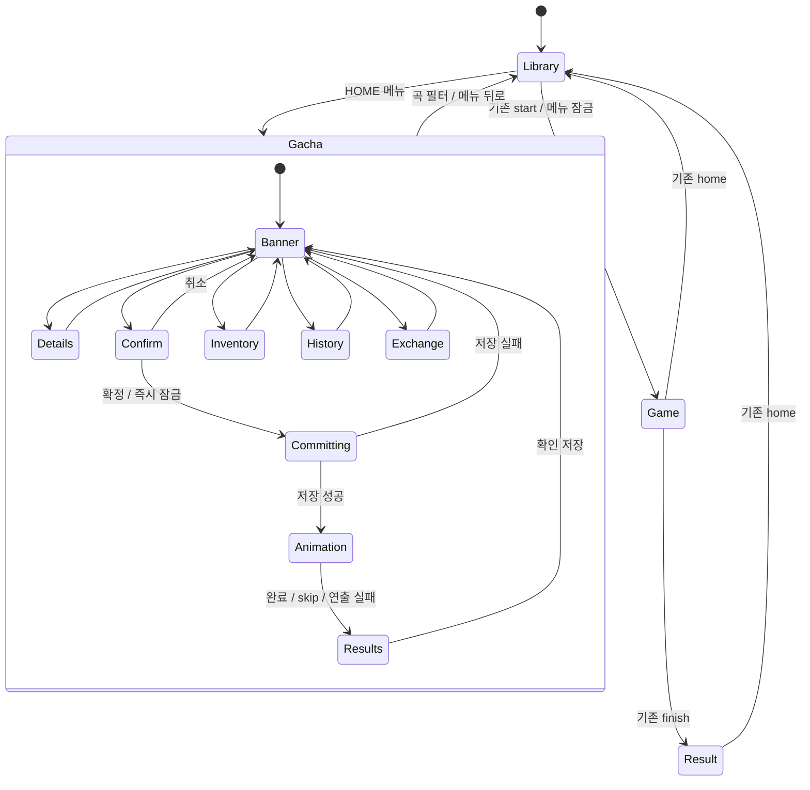
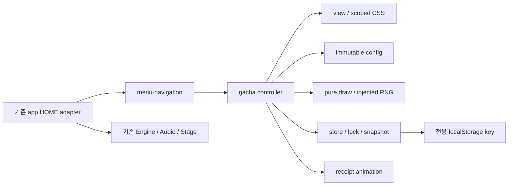

# 가챠 DAY 1 — 아키텍처와 후속 구현 계약

현재 DAY 3 구현: [배너 선택 계약과 검증](day3.md). 아래 DAY 1 계약의 `placeholderArtKey`는 표시용 `artKey`로 구체화했다. 표시 데이터는 `id/title/subtitle/previewLabel/artKey/themeKey`이며, 추첨 규칙 필드는 아직 구현하지 않았다. 아래 설계 기록과 이후 구현을 구분한다.

기준: 2026-10-26 KST. 아래 DAY 1 본문은 당시의 **설계 기록**이다. 현재 구현과 우선 일정은 말미의 DAY 2 정정을 따른다.
무료 시뮬레이션만 대상으로 한다. 14일간 임시 카드 ID·희귀도·독창적인 기하학 그래픽만 사용한다.
실제 캐릭터 이름·이미지·스토리·고유 스킬, 결제·충전·광고 보상·현금화·실물 교환은 제외한다.
게임 보상과 가챠 재화를 연결하지 않는다. 초기 무료 잔액 및 지급 정책은 별도 결정 전까지 미정이다.

## 1. 확인한 기준과 변경 경계

- Git 루트: `C:\Users\MSII\Documents\Codex\rythem_game-pages-staging`.
- 원격: `https://github.com/haepul/rythem_game.git`, 브랜치 `main`.
- HEAD: `19bc813daeffe3ea2d1c4a4410b082ddb2176706`; 사용자 조사 기준과 일치.
- 초기 작업 트리 깨끗함. `C:\Users\MSII\Desktop\game`은 Git 저장소가 아니므로 작업 대상으로 쓰지 않았다.
- 루트 상위 경로 및 저장소 내 적용 가능한 `AGENTS.md`는 발견하지 못했다.
- 기존 가챠 파일·동일 목적 문서·`package.json`은 검색에서 발견하지 못했다.
- 오늘 허용 변경: 이 문서, [출처](references.md), [검증 계획](validation-plan.md), README 문서 링크만.
- `core.mjs`, `renderer.mjs`, `audio.js`, `play-hud.mjs`, `data/`, 원본 및 유리 버전은 읽기 전용 경계다.

### 현재 코드의 통합 지점

위치의 행 번호는 위 HEAD 기준이다. 축약된 소스이므로 함수/선택자를 함께 기재한다.

| 근거 | 현재 역할 / 위험 | 후속 통합 결정 |
|---|---|---|
| `index.html:4–11`, `#home .rail`, `.workspace .topbar`, `main.selection` | 메뉴 셸과 곡 선택 영역 | 셸 유지, 콘텐츠에만 library/gacha 컨테이너 도입 |
| `app.mjs:13`, `view`, `state` | all/favorites/records와 HOME 등 게임 상태 | `menuScreen`을 새 독립 상태로 둠 |
| `app.mjs:30`, `renderLibrary()` | 모든 `[data-view]`의 active/aria-pressed, 검색/정렬 변경 시 페이지·스크롤 초기화 | data-view에 gacha 금지; 복귀 때 필터 값을 바꾸지 않음 |
| `app.mjs:34`, 필터 onclick | view 변경 후 렌더링 | 먼저 library 진입, 이후 기존 필터 처리 |
| `app.mjs:27,31`, `entry()/renderDetail()` | `songs[selected]`를 바로 참조 | 카탈로그 준비 전 메뉴 전환에서 호출하지 않음 |
| `app.mjs:47`, `home()` | 오디오 취소·입력 해제·엔진 clear까지 수행 | 메뉴 탭 전환에 home() 재사용 금지 |
| `app.mjs:56`, `start()` | LOADING→COUNTDOWN, 비동기 generation 보호 | HOME/library/유효한 곡에서만 시작, 메뉴 라우팅 잠금 |
| `app.mjs:57–59`, `finish()` | RESULT 표시, 일반 성공 기록 저장 | 메뉴 잠금 유지; 가챠 보상·저장 호출 추가 금지 |
| `app.mjs:8–12,37–45` | 설정·즐겨찾기·기록 저장 및 설정 dialog | 기존 저장 키·동작 보존; 새 거래 저장기 별도 |
| `app.mjs:9`, `save()` | 오류를 toast로 삼키고 반환 | 거래 성공 확인 불가하므로 재사용 금지 |
| `app.mjs:46`, `closeDialogs()` | 모든 열린 dialog를 닫음 | start 전 가챠 teardown; 게임 dialog와 가챠 dialog 중첩 금지 |
| `app.mjs:51`, 전역 keydown | ESC 및 +/- 볼륨 | 가챠 ESC는 자기 dialog에서 소비; 게임 키 브리지 변경 금지 |
| `transitions-ui.mjs:1–12` | 로딩 안내·카운트다운·결과 테마 | 일반 메뉴 라우터로 확대하지 않음 |
| `settings-motion.mjs:3–16` | 종료 animation/token/cancel | 취소 계약의 참고만; 가챠가 pause/resume 콜백 사용 금지 |
| `renderer.mjs:6–7`, `Stage.init()` | 800×480 Pixi Application, 노트·판정 컨테이너 | 가챠가 Stage 인스턴스·텍스처·ticker를 공유하지 않음 |
| `audio.js:233–243` | 전역 키/포인터 이벤트·unlock | 가챠는 엔진/오디오 입력을 켜지 않음 |
| `ui-system.css:2–22,48` | 공통 토큰, 모달 닫기 최소 36px | 가챠 내부 닫기는 44px 이상으로 보완 |
| `style.css:4–5`, `song-select.css`, `song-detail.css`, `ui-polish.css` | 셸/곡 화면 및 전체 hover·모션 덮어쓰기 | 신규 CSS는 가챠 범위에 한정, 기존 선택자 영향 시험 |

`rhythm-next-settings`, `rhythm-next-favorites`, `rhythm-next-records`를 코드에서 확인했다.
후보 `rhythm-next-gacha-v1`은 현재 runtime 소스 검색에서 충돌하지 않았다. 같은 origin의 다른 앱과도 공유되는 저장 공간이므로 경로만으로 격리된다고 가정하지 않는다.

## 2. 메뉴·history 계약

`state`의 HOME/LOADING/COUNTDOWN/PLAY/PAUSED/CLEAR/RESULT는 그대로 유지한다.
`menuScreen = library | gacha`는 HOME 내부에만 유효하다. 가챠 하위 뷰는 controller의 별도 상태다.
새 메뉴 버튼은 `data-screen="gacha"`; 기존 세 필터는 `data-view`를 유지한다.

| 표시 소유자 | 책임 |
|---|---|
| 메뉴 navigation | 콘텐츠 hidden, 현재 화면, 가챠 메뉴 active/aria-pressed |
| renderLibrary + 최소 HOME adapter | 저장된 view 유지. library에서만 선택 필터의 active/aria-pressed=true, gacha에서는 세 필터 모두 false |
| controller | 배너 선택·결과·보관함 상태, 가챠 내부 선택 표시 |

곡 필터 클릭: HOME 검사 → library 복귀 → 사용자가 고른 view 적용 → 기존 renderLibrary.
가챠 왕복만으로 selected, level, length, view, search.value, sort.value, songPage, lastLibraryFilter를 바꾸지 않는다.
library DOM을 파괴하지 않고 숨긴다. 진입 직전 song-grid.scrollTop, window.scrollY, 복귀 focus 대상을 메모리로 보관한다.
복귀 후 레이아웃이 열린 다음 한 프레임에 스크롤을 복원한다. 필터를 명시적으로 바꿨을 때만 기존 초기화 규칙을 적용한다.
리로드 후 곡 선택 복원은 현재 기능에 없으므로 오늘 세션 간 보존을 약속하지 않는다. URL은 메뉴 목적지만 복원한다.

### Hash 정책 (신규 제안)

기존 `.mjs/.html`의 history/hashchange/location.hash/pushState/replaceState/popstate 사용 검색은 일치 없음.
`#/library`, `#/gacha`만 허용한다. path와 `?v=20261022-track`은 보존하며 서버 라우팅은 추가하지 않는다.

| 입력 | 동작 |
|---|---|
| 최초 hash 없음 | replaceState로 #/library 정규화; 초기 이력 추가 없음 |
| 직접 #/gacha 또는 리로드 | HOME에서 해당 화면 마운트; 카탈로그 fetch와 독립, 미확인 receipt가 있으면 결과 복구 우선 |
| 잘못된 hash | replaceState로 #/library, 상태값 검증; 임의 문자열을 innerHTML에 넣지 않음 |
| 메뉴 클릭 | 다른 목적지에만 pushState; 같은 메뉴 재클릭은 no-op; pushState 뒤 직접 단일 applyRoute 호출 |
| 뒤로/앞으로·주소창 hash 변경 | popstate/hashchange 공통 핸들러에서 정규화한 route가 같으면 no-op; 재귀 push 금지 |
| HOME 밖 hash 변경 | 메뉴 진입 거절, replaceState로 마지막 유효 메뉴 hash 복원; 오디오·엔진·게임 상태에는 손대지 않음 |
| 문서 밖으로 뒤로가기 | 브라우저 기본 동작 유지; 같은 문서 history만 관리, 무한 이력 방어 금지 |

열린 dialog 우선순위: HOME의 settings/help 또는 가챠 상세/확인 창을 먼저 닫고 대상 화면으로 이동한다.
PLAY/PAUSED의 dialog는 메뉴 라우터가 닫지 않는다. ESC는 최상위 dialog 취소가 우선이고, 닫힌 가챠 하위 뷰에서는 가챠 홈으로 복귀한다.
추첨 확정 전 확인창 닫기는 무거래 취소다. 저장 중 route 요청은 마지막 하나만 대기시키며 거래 완료/실패 뒤 적용한다.
저장 후 연출 중 이탈은 연출만 취소한다. pending receipt를 보존해 다음 가챠 진입에 결과를 재표시한다.
모달을 history entry로 만들지 않는다. 라우팅 핸들러는 init 한 번 등록하고 teardown 때 제거한다.

최소 생명주기 연결:
- `home()`: 기존 정리 완료 뒤 navigation.resume('library'), 카탈로그 유효 시에만 detail 렌더. 빈 목록은 안내와 start/practice disabled.
- `start()`: HOME/library 및 곡 존재 검사 후 navigation.suspend(); 가챠 마운트·타이머 정리. 비동기 로딩·오디오 스케줄은 그대로.
- `finish()`: 기존 RESULT 처리 유지, navigation은 계속 suspended. 결과의 홈 버튼은 기존 home()으로 복귀.
- 메뉴 초기화는 catalog await 전에 수행. catalog 실패 시 library 오류 안내와 가챠 진입은 독립적이다. 빈 목록 예외는 위 경계에서 방지하고 게임 자체를 재작성하지 않는다.



## 3. 화면 설계 — 아직 구현하지 않은 와이어프레임

공통 셸은 기존 rail/topbar. 아래 비율·레이아웃은 우리 초기안이며 공식 실측치가 아니다.

```text
PC HOME
┌기존 rail┬기존 topbar─────────────────────────────────┐
│필터     │가챠 / 무료 시뮬레이션       잔액 / 보관함 / 기록│
│GACHA    ├배너 목록 22%┬독립 기하학 비주얼 48%┬정보 30%┤
│         │선택 테두리 │배너 제목·임시 카드 ID  │상세·확률│
│         │다른 배너   │희귀도 텍스트·별        │1회/10회 │
│         │           │                       │교환 안내│
└─────────┴───────────┴───────────────────────┴────────┘
모바일 HOME
[기존 내비게이션][제목 / 무료 잔액]
[배너 선택 목록: 가로 스크롤, 선택 항목 명시]
[기하학 비주얼][제목·희귀도·상세/확률]
[1회] [10회] [보관함] [기록] [교환]
```

| 화면 | 정보/와이어프레임 | 실제 동작 계약 |
|---|---|---|
| 가챠 홈·배너 선택 | 위 구조. 선택 배너 테두리+체크+aria-pressed | 배너 변경 시 동일 버전 정보/비용 갱신. 준비되지 않은 배너는 이유와 disabled |
| 상세·확률 | `[배너 제목 / 닫기] → [버전·풀·카드ID/희귀도/확률 표] → [보장/보너스/교환 설명]` | 긴 표는 모달 안 스크롤, 확률은 같은 config에서 산출. 미결정 규칙은 공개 추첨 차단 |
| 추첨 확인 | `[추첨 확인] → [배너 / 횟수 / 비용 / 현재→예상 잔액] → [취소][확정]` | 열 때 버전 고정; 확정 시 최신 잔액 재검증. 부족하면 확정 disabled, 충전 버튼 없음 |
| 연출 | `[닫기/건너뛰기] [중앙 기하학 광원 / 카드 윤곽] [공개 안내]` | 저장된 receipt만 소비. 탭/Enter로 진행, 자동 종료 상한. 무음 기본; 기존 음악 사용 금지 |
| 단일 결과 | `[획득 결과] [카드 크게 1장] [ID·별·희귀도·NEW·보유 수] [확인]` | NEW는 receipt 값; 재표시 시 재계산 금지 |
| 10회 결과 | `[결과 요약] [1 2 3 4 5 / 6 7 8 9 10] [확인]` | 좁은 화면 2열×5행, 원래 추첨 순서 유지. 카드별 접근 가능한 이름 |
| 보관함 | `[돌아가기 / 희귀도 필터 / 정렬] [ID·별·개수 카드] [페이지]` | 실제 보유만 표시, 빈 상태 안내. 없는 ID도 fallback 카드 유지 |
| 기록 | `[돌아가기] [날짜 / 배너 / 횟수 / 비용 / 결과 보기] [페이지]` | receipt 재조회는 무차감·무추첨. 오래된 버전 정보 보존 |
| 교환 | `[배너별 보유 스티커] [대상 ID / 필요 수량] [교환 확인]` | 규칙 확정 후에만 활성화. 보유 차감+카드 증가+교환 영수증을 동일 저장 경로로 처리 |

교환 거래는 DrawReceipt에 억지로 count를 넣지 않는다. 후속 ExchangeReceipt(id, bannerId, configVersion, cardId, stickerCost, createdAt)를 같은 receipts의 판별 가능한 `kind` 확장으로 설계하고 스키마 버전을 올린다. 교환 구현 전에 계약·복구·마이그레이션 시험을 먼저 승인한다.
아직 기능이 없는 화면의 버튼은 DAY 2에 가짜로 노출하지 않는다. 이 와이어프레임은 구현 단계별 목표다.

### 토큰·접근성·반응형

기존 `ui-system.css`를 우선 사용한다: `.ui-panel`, `dialog.ui-modal`, `.ui-button`, `.ui-button--accent`.
기존 토큰: cyan #19d4c5, mint #66e9d2, purple #a68ae8, pink #ff69b5, white #f8faff,
text #41445c; 간격 4/8/12/16/24/32px; radius 6/10/18px; hit 44px;
모션 120/200/320ms 및 cubic-bezier(.2,.8,.2,1); Stage/system-ui 폰트, panel/modal shadow 및 highlight.
민트는 강조 면에, 작은 글씨는 기존 dark text/selected 토큰에 배치한다.

신규 제안: 본문 gap 24px(좁을 때 12px), 배너 선택 윤곽 2px, 모달 최대 폭 min(720px, 가용폭),
10회 결과 5열→2열, 패널 진입은 opacity/transform 200ms. 연출 길이와 희귀도 확률·비용은 미정이다.
모든 새 스타일은 `.gacha-*` 또는 가챠 컨테이너 내부에 한정한다. body/.nav/.primary 전역 덮어쓰기 금지.
`.gacha-modal .close`는 기존 36px 대신 min-width/min-height:var(--ui-hit)를 적용한다.
기존 `.ui-modal` backdrop 필터가 적용되면 가챠 범위에서 blur를 제거하고 반투명 색만 사용한다.

- 최소 너비 0, 제목 overflow-wrap:anywhere; 카드 제목 생략 시 accessible name에는 전체 ID/제목.
- 200% 글자 확대 시 행 높이 자동, 중요한 금액/확률은 잘라내지 않는다.
- 360×800, 390×844, 844×390, 1280×720에서 검사. 낮은 높이에서는 비주얼 축소 및 문서/모달 내부 스크롤, 고정 액션이 본문을 덮지 않게 한다.
- safe-area-inset-* 여백, 100dvh 최대 높이, 가로 회전 시 선택·확정 receipt 유지. 페이지 전체 가로 넘침 금지; 배너 내부 가로 스크롤만 허용.
- 희귀도는 별 개수+문구+테두리를 병용. NEW는 텍스트 배지. 장식 SVG는 aria-hidden.
- dialog는 aria-labelledby, 설명은 aria-describedby, showModal로 열고 제목/첫 안전한 요소에 focus. ESC=취소 또는 결과 확인으로 이동; 거래 중 ESC는 거래를 재실행하지 않는다.
- 닫을 때 트리거가 살아 있으면 focus 복귀, 아니면 해당 화면 제목으로. 결과 요약은 aria-live=polite 한 번, 카드를 프레임마다 읽지 않는다.
- effects OFF 또는 prefers-reduced-motion이면 이동/확대/파티클 없음. 저장 후 즉시 정적 결과를 제공하며 기능/확률 차이 없음.
- 상시 RAF·전체 화면 blur·카드별 필터 금지. 가챠 이탈 후 활성 animation/timer는 0이어야 한다.

## 4. 모듈 계약과 의존 방향

아래 파일은 후보이며 오늘 생성하지 않는다. 반환 오류는 구분 가능한 code와 사용자 메시지로 표현한다.

| 후보 | 입력 → 출력 | 오류 | 의존·생성·해제 책임 |
|---|---|---|---|
| menu-navigation.mjs | getGameState, 콘텐츠 roots, 전환 callback → mount/navigate/suspend/resume/destroy | INVALID_ROUTE, NOT_HOME | 브라우저 history만 소유. init 1회 listener, destroy 제거; 게임 엔진 import 금지 |
| gacha/controller.mjs | view/store/config/draw/animation 주입 → 화면 모델·거래 결과 | BUSY, INSUFFICIENT_BALANCE, CONFIG_CHANGED, STORE_FAILED | 가챠 세션 및 requestID 소유. 클릭마다 mount 금지; 이탈 AbortController 취소, 저장 완료 콜백의 stale DOM 접근 금지 |
| gacha/view.mjs + gacha.css | 검증된 모델 → DOM 및 intent callback | MISSING_ROOT, INVALID_MODEL | 단일 root 이벤트 위임 1회. update는 listener 추가 금지; unmount DOM/리스너/focus 정리 |
| gacha/config.mjs | 정적 정의 → 검증·동결된 버전 snapshot, 표시 확률 | UNKNOWN_CARD, INVALID_WEIGHT, INVALID_RULE | DOM/storage 없음, 버전별 보관; mutable 참조를 반환하지 않음 |
| gacha/draw.mjs | snapshot, count, 이전 보너스, RNG → 순서 있는 결과와 다음 카운터 | RNG_RANGE, INVALID_POOL, UNSUPPORTED_RULE | 순수 함수. RNG는 [0,1) 유한 값, 시간/DOM/storage 접근 금지 |
| gacha/store.mjs | storage/lock/clock/id 주입, transaction → 검증 snapshot/receipt | CORRUPT, UNKNOWN_SCHEMA, QUOTA, BLOCKED, LOCK_UNAVAILABLE | 모든 쓰기 독점 담당. lock 안 최신 읽기, commit 성공만 반환; storage listener 1회, destroy 제거 |
| gacha/animation.mjs | 확정 receipt, effects flag, signal → completed/skipped/cancelled | ASSET_FAILED (정적 결과 fallback) | 전용 DOM/SVG 우선. Web Animations 취소·timer 해제. gameplay Stage 사용 금지 |



View와 animation은 직접 store를 쓰거나 draw를 호출하지 않는다. draw 결과만으로 성공 UI를 띄우지 않는다.
모든 마운트는 중복 호출 방지; 화면을 숨긴 뒤 완료되는 Promise는 세션 token을 검사한다.
저장 시작 후 abort는 UI 이탈일 뿐 거래 rollback이 아니다. lock은 저장까지 보유하고 연출 전에 해제한다.

## 5. 데이터 계약

모든 ID는 비어 있지 않은 안정적인 문자열, 수량/잔액/revision은 음이 아닌 safe integer다.
시각 표시와 추첨은 동일한 bannerId+configVersion snapshot을 사용한다. 확률은 weight 합으로 계산하되 보장 슬롯/보너스에 따른 조건부 확률을 구별해 표시한다. 오늘 숫자 정책은 확정하지 않는다.

| 계약 | 필드 / 불변 조건 |
|---|---|
| CardDefinition | `id, rarity, artKey`. 이름은 임시 ID에서 생성. rarity는 정의된 enum; 실제 이름·스토리·스킬 없음 |
| PoolEntry | `cardId, weight`. 참조 유효성, 유한 양수 weight와 합 검증; 중복 cardId는 설정 오류로 거절 |
| BannerDefinition | `id, configVersion, title, placeholderArtKey, pool, costs, guaranteeRule, bonusRule, exchangeRule`. 미정 규칙과 disabled 규칙 구별. 버전 변경 시 덮어쓰기 대신 새 snapshot |
| DrawReceipt | `id, bannerId, configVersion, count, cost, createdAt, results[{cardId,rarity,isNew}], presentedAt`. id=transactionID, count=결과 수, cost=실제 차감량, UTC ISO 시간, presentedAt은 미확인 null |
| InventoryEntry | `cardId, ownedCount, firstAcquiredAt, lastAcquiredAt`. 최초 획득 시간 보존, 중복도 ownedCount 증가 |
| SaveEnvelope | `schemaVersion, revision, balance, inventory, receipts, pendingPresentationId, stickersByBanner, bonusByBanner`. map 키는 ID, receipt 배열 ID 유일, pending은 존재하는 미확인 receipt 또는 null |

같은 10회에서 A,A를 뽑고 기존 A가 없으면 첫 A만 isNew=true, 둘째는 false다.
작업 중 임시 소유 집합에 첫 A를 즉시 추가해 계산하며 결과 재열람 때 NEW를 바꾸지 않는다.
cardId는 아트 교체 때도 불변. 3주 차에는 artKey resolver를 확장하고 저장 ID를 재발급하지 않는다.
정의에서 사라진 ID는 기록/보관함에 `미등록 카드 · ID`와 자체 fallback 도형을 표시한다. 수량·과거 rarity는 지우지 않는다.
보너스/스티커는 배너별로 격리하고 임의 이월 금지. 이월·교환·보장 순서는 향후 config 정책으로 명문화해야 한다.
확인창 이후 버전이 달라지면 자동으로 바꿔 추첨하지 않고 창을 갱신해 재확인을 받는다.

## 6. 거래·실패·복구

전용 키 후보 `rhythm-next-gacha-v1`에 검증된 전체 JSON snapshot을 한 번 setItem한다.
단일 키 쓰기는 여러 필드의 부분 저장을 피하는 방법이며, read-modify-write의 탭 간 원자성이나 영구 디스크 보장을 뜻하지 않는다.

1. 확인 클릭 즉시 UI in-flight 잠금, 새 transactionID 생성. 재시도는 같은 ID를 사용한다.
2. 동일 origin의 고정 이름 `rhythm-next-gacha-write-v1` Web Lock을 exclusive로 획득한다.
3. lock 안에서 최신 snapshot 읽기/검증. 동일 receipt ID가 있으면 기존 결과 반환. pending이 있으면 새 추첨 대신 복구.
4. 선택 configVersion·비용·잔액·수량·보장 규칙 재검증. RNG로 결과 계산, 소유/카운터/잔액/receipt/pending/revision을 복제본에서 함께 갱신.
5. 전체 복제본 검증·직렬화 후 setItem 성공 확인. 실패하면 기존 메모리/잔액 유지, 성공 연출 금지.
6. 성공 snapshot만 메모리에 공개하고 lock 해제. 그 뒤 receipt 기반 연출.
7. 결과 확인도 같은 lock으로 최신 snapshot을 읽고 해당 receipt의 presentedAt 갱신·pending 해제. 저장 실패하면 pending 유지하고 확인 재시도 제공.

연출 실패·skip·리로드는 저장된 결과를 정적으로 표시한다. 재추첨·재차감 금지.
미확인 receipt는 하나만 허용한다. 저장 직후 탭이 닫혀도 다음 진입은 pending 복구가 우선이다.
연출 중 탭을 바꿔도 동일 receipt를 복구할 수 있으며, 한 탭의 확인이 다른 탭에서 중복 반영되지 않게 확인 쓰기도 lock을 쓴다.
storage 이벤트는 다른 탭의 화면 갱신 힌트일 뿐 잠금이 아니다. revision도 변경 감지용이지 CAS/원자적 mutex가 아니다.

Web Locks 지원/secure context/획득 실패를 감지한다. 미지원 환경은 보관함·기록 읽기 전용으로 두고 모든 쓰기(추첨·교환·초기화·확인 저장)를 차단한다.
localStorage lease나 탭 개수 추정으로 단일 writer라고 주장하지 않는다. DAY 5까지 Android/iOS 대상에서 정책을 충족하지 못하면 IndexedDB readwrite 트랜잭션 대안을 별도 검증한다.
혼합 버전 모든 writer도 같은 lock 계약을 따라야 한다. 클라이언트 저장은 사용자의 수동 수정/브라우저 데이터 삭제/기기간 동기화를 방어하지 못하며 무료 로컬 시뮬레이터로 안내한다.

| 실패 | 처리 정책 |
|---|---|
| 키 없음 | 명시적 초기 무료 정책이 확정된 뒤에만 신규 snapshot 생성; 오류를 키 없음으로 치환 금지 |
| 손상 JSON, 타입 불일치, 음수/NaN/Infinity, 관계 불일치 | 쓰기 차단·오류 안내. 원문을 덮어쓰지 않고 백업 내보내기 제공 |
| 알 수 없는 schemaVersion | 읽기/쓰기 차단, 지원 버전 안내. 자동 downgrade/초기화 금지 |
| 지원 구버전 | 순수 migration 검증 → 원문 백업 보존 → 같은 lock에서 전체 저장. 실패 시 원본 유지 |
| quota 또는 저장 차단 | 오류별 안내, 기존 snapshot 유지, 추첨 성공 UI 금지. 다른 게임 키 삭제 금지 |
| 기록 증가 | DAY 5에 직렬화 크기/시간·상한 결정. 상한 근접 시 경고·새 추첨 차단. 자동 오래된 receipt 삭제 금지 |
| 사용자 선택 초기화 | 전용 원문 백업을 먼저 성공적으로 내보낸 뒤 명시적 확인. 가챠 키만 교체; 백업 실패면 초기화 중지 |
| ack 저장 실패 | 결과 유지·확인 재시도. 재조회/재시도는 원래 receipt 사용 |

기록을 무단 정리하면 idempotency 근거가 사라진다. 향후 보관 정책은 pending 및 transaction 중복 방지 기록을 보존하는 별도 스키마 설계가 필요하다.
오늘 실제 브라우저 저장소를 직접 읽거나 쓰지 않았다. 기존 페이지 초기화 관찰 외에 설정·기록을 변경하는 조작도 하지 않았다.

## 7. DAY 2 최소 범위와 다음 단계

| 파일 후보 | DAY 2 허용 최소 구현 | 완료 기준 |
|---|---|---|
| index.html | 기존 콘텐츠 wrapper와 HOME 전용 가챠 진입, 돌아가기 가능한 안내 영역 | 동작 없는 추첨/교환 버튼 없음, 기존 ID 보존 |
| menu-navigation.mjs | 두 메뉴/hash/guard/초기history/teardown | 왕복·back/forward·unknown hash·PLAY 거절 시험 |
| app.mjs | data-view adapter, HOME/start 경계, catalog 준비 guard | 선택/검색/정렬/페이지/스크롤 복원, 빈 catalog 오류 없음 |
| gacha.css | 안내 영역과 최소 메뉴 강조를 범위 한정 | 기존 화면 CSS 영향 없음, 44px target |
| tests/test_menu_navigation.mjs (신규 후보) | 순수 route/guard/history 및 상태 복원 테스트 | 기존 테스트인 것처럼 보고하지 않음 |
| 이 문서/validation-plan.md | 실행한 결과만 추가 | 문서와 구현 계약 차이 기록 |

DAY 2에는 draw/store/config/animation 빈 파일도 만들지 않는다. 초기 안내는 준비 상태와 돌아가기 기능만 제공한다.
진입 조건: 기준 diff 재확인, 누락 테스트의 실제 원본/재현 경로 확보 계획, route/dialog/empty-catalog 계약 합의.
게임 코드 수정이 필요한 별도 결함은 근거를 기록하고 범위를 확장하지 않는다.

후속 순서 제안(날짜는 DAY 1 기준): DAY 3(10/28) 카드·배너 계약/독립 도형,
DAY 4(10/29) RNG 주입 추첨/보장 단위 테스트, DAY 5(10/30) 저장·잠금·복구 gate,
DAY 6(10/31) 배너/확률 UI, DAY 7(11/1) 확인/거래 연결, DAY 8(11/2) 정적 결과,
DAY 9(11/3) 제한된 연출, DAY 10(11/4) 보관함/기록, DAY 11(11/5) 교환 계약/구현,
DAY 12(11/6) 모바일/접근성, DAY 13(11/7) 회귀/실패 주입, DAY 14(11/8) 통합 검증.
날짜가 됐다는 이유로 미통과 gate를 건너뛰지 않는다. 배포는 별도 요청과 검증 이후다.

## 8. DAY 2 현재 상태와 일정 정정 (2026-10-27)

현재 작업 기준 HEAD는 `b7b5d1b4a7fd45cf36f8271852d6c6da872205f8` (`main`)이다.
위 DAY 1의 `19bc813...`와 깨끗한 트리 표기는 당시 기록이며 현재 기준이 아니다.
시작 시 README 수정과 이 디렉터리의 DAY 1 문서 3개가 미커밋 상태였으며 보존했다.

구현: `MenuNavigation`은 HOME guard와 hash/history를 관리한다. `app.mjs`의 adapter는
`menuScreen`과 기존 곡 필터 `view`를 분리하고 library DOM의 hidden만 전환한다.
`gacha/view.mjs`는 정적인 독창 도형과 복귀 callback만 가진다. 저장·RNG·Engine 의존성이 없다.
DAY 3 배너의 실제 마운트 지점은 `#gacha-screen #gacha-content`이다.
현재는 패널 안의 정적 내용을 교체할 수 있으며, 복귀 버튼 listener를 교체할 때 반드시 기존 view의 destroy를 사용한다.

사용자 확정 일정이 DAY 1의 후속 제안보다 우선한다:

| DAY | 범위 |
|---|---|
| 3 | 배너 |
| 4 | 상세·확률 안내 |
| 5 | 무료 재화·상태 |
| 6 | 추첨 엔진 |
| 7 | 실행 통합 |
| 8 | 진입 연출 |
| 9 | 희귀도 연출 |
| 10 | 결과 |
| 11 | 기록·보관함 |
| 12 | 스티커·교환·보너스 |
| 13 | 통합 검증 |
| 14 | 마감 |

이번 구현과 검증은 [DAY 2 보고서](day2.md)에 별도로 기록한다. 추후 저장은 별도 키·버전,
추첨 엔진/UI 및 카드 ID/표현 자산 분리 계약을 유지한다.
