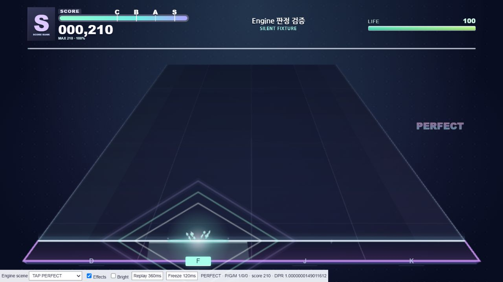
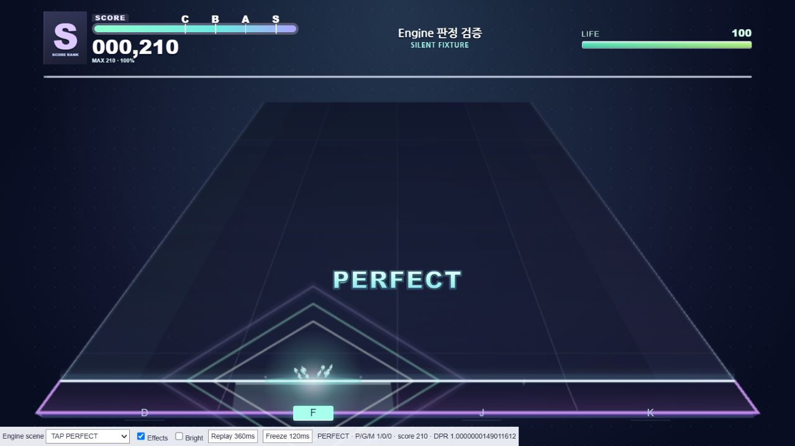

# 판정 텍스트 DAY 8 — 로컬 검증 (2026-10-28)

기준 HEAD `b7b5d1b4a7fd45cf36f8271852d6c6da872205f8`. 기존 DAY 2 미커밋 변경을 보존했다. commit/push/배포는 수행하지 않았다.

## 변경

- `play-hud.css`: 오른쪽의 작은 판정 문구를 800×480 기준 중심 (400,300), 26px로 이동. PERFECT 흰색→민트→하늘색, GREAT 분홍→연보라, MISS 차분한 코랄. 얇은 어두운 외곽과 작은 그림자만 사용한다.
- `play-hud.mjs`: 실제 Engine.feedback/feedbackAt로 최신 판정 하나만 표시. 위치 wrapper와 내부 span 애니메이션을 분리했다. 360ms 동안 등장→확대→정착→퇴장하며 pause 이후 실제 판정 나이에 맞춘다. 효과 OFF/reduced-motion에서는 이동을 생략한다.
- `index.html`: 판정 span 및 HUD 캐시 버전. `app.mjs`: HUD import 버전만 변경. 기존 가챠 연결은 보존했다.
- `tests/judgment-text-scenes.mjs`, `test_judgment_text.mjs`, `judgment-text.html`, `fixtures/judgment-text-before.*`: 실제 Engine 입력 기반 회귀 및 전후 비교 fixture.

사용자가 제공한 PERFECT/GREAT 스크린샷의 중앙 배치, 민트/분홍 대비와 외곽선을 참고했다. 원본 자산을 삽입하지 않았다. 영상 링크는 가져오기 실패로 시청하지 못했으며 360ms는 우리 구현값이다.

## 실제 검증

`node --test tests/test_judgment_text.mjs`: 18개 통과. TAP/FLICK/HOLD 시작·중간·끝/SLIDE, 4레인, 연속 40 PERFECT, 등급 전환, MISS, 효과 OFF, reset, 지연 프레임 및 60/120Hz 시간 시뮬레이션을 포함한다. `node tests/test_judgment_3d.mjs`와 메뉴 7개 테스트도 통과했다.

브라우저 fixture에서 모든 장면을 선택해 확인했다. PERFECT 210, GREAT 105, HOLD 끝 660, 4레인 900, 40 PERFECT 16,200, PERFECT→GREAT 320, GREAT→MISS 105. 실제 MASTER 채보 무입력 시뮬레이션은 1,158 MISS이며 사람이 플레이한 결과가 아니다.

1366×768, 844×390, 800×360에서 논리 중심은 약 (400,300)으로 유지되고 문구 잘림이 없었다. 1280×720의 동일한 PERFECT 장면에서 전후 캡처했다. 밝은 배경 fixture와 효과 OFF도 확인했다. 밝은 배경은 합성색이며 실제 MV가 아니다.

실제 앱의 나다움 HARD 1절 연습에서 진행·일시정지·재개·재시작·메뉴 복귀와 MISS 표시를 확인했다. 브라우저 runtime error 로그는 없었다. 청음으로 오디오 싱크를 측정한 것은 아니다.

동일 상태 HUD update 10,000회: 평균 0.0097ms, p95 0.1000ms, 판정 subtree DOM mutation 0회. 브라우저 타이머의 해상도 영향을 받는 CPU 미세 측정이며 실제 FPS 또는 전후 성능 향상 수치가 아니다.

## 실제 캡처

| 수정 전 | 수정 후 |
|---|---|
|  |  |

[GREAT](judgment-text-great.png) · [MISS](judgment-text-miss.png) · [연속 판정](judgment-text-dense.png) · [SLIDE](judgment-text-slide.png) · [MASTER](judgment-text-master.png) · [밝은 배경](judgment-text-bright-bg.png) · [효과 OFF](judgment-text-effects-off.png) · [모바일](judgment-text-mobile.png) · [실제 플레이](judgment-text-live.jpg)

## 한계

DPR≈1의 viewport 검증이다. DPR2 및 Android/iOS 실기기, 물리 터치, OS reduced-motion/forced-colors 실제 전환, 실제 60/120Hz FPS와 청음 검사는 미실행이다. 해당 접근성 CSS 경로는 구현했지만 코드 검사와 실제 설정 검증은 구분한다. 기존 판정·스코어·음악·렌더러·채보를 수정하지 않았다.
